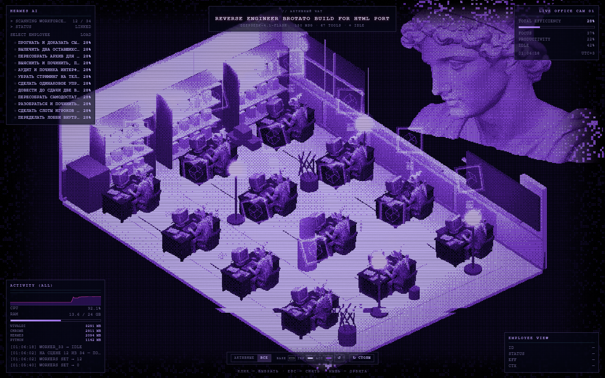

# office_hermes — изометрический офис агентов для Hermes

Живой наблюдательный экран: панель справа показывает изометрический офис, за столами
сидят **реальные субагенты текущего чата**, над работающими крутятся кубики, в логах
летят их сообщения и тулзы, слева — CPU/RAM машины. Нажатие на фигуру показывает её
данные. Всё локально: сервер слушает `127.0.0.1`, база Hermes открывается **только на чтение**.


```
Hermes desktop                        ваш компьютер
┌──────────────┬───────────┐
│  чат         │ панель    │  iframe   ┌──────────────────────────┐
│              │ office_   │ ────────► │ office_live.py :8797     │
│  state.db ───┼───read────┼──────────►│  /state /health /beacon  │
│  (Hermes)    │  plugin.js│           │  office.html (модель вшита)│
└──────────────┴───────────┘           └──────────────────────────┘
```

## Что нужно

* Hermes desktop (панели плагинов) — Windows/macOS/Linux;
* Python 3.10+ (`pythonw.exe` на Windows), **без pip-зависимостей**;
* Node.js — только если хотите пересобирать страницу офиса.

## Установка (Windows, один шаг)

```powershell
git clone https://github.com/<ваш-логин>/hermes-office.git
cd hermes-office
powershell -ExecutionPolicy Bypass -File scripts\install.ps1
```

Из git-bash то же самое: `bash scripts/install.sh`.

Скрипт сам: находит `pythonw.exe` → копирует фид в `%LOCALAPPDATA%\hermes\office-live\` →
кладёт панель в `%LOCALAPPDATA%\hermes\desktop-plugins\office-hermes\` (с вашим портом) →
создаёт автозапуск `Startup\hermes-office.vbs` → поднимает фид и проверяет `/health`.

Дальше в Hermes: **Ctrl+K → «Reload desktop plugins»**. Панель `office_hermes` появится
справа (или чип `office_hermes` в статусбаре). Прямой адрес офиса: <http://127.0.0.1:8797/>.

Полезные ключи: `-Port 8801`, `-HermesHome D:\hermes`, `-PythonExe C:\Python312\pythonw.exe`,
`-NoAutostart`, `-NoStart`, `-Open`.

### macOS / Linux

```bash
bash scripts/install.sh --start
```
Кладёт файлы в `$HERMES_HOME` (`~/.hermes`), поднимает фид через `python3`. Автозапуск —
systemd --user или `~/.config/autostart/*.desktop` (строка `Exec=` печатается в конце).

### Только панель, через встроенный установщик Hermes

Hermes умеет ставить плагины из git: *Settings → Plugins → Install from Git* → `<логин>/hermes-office`.
Тогда `plugin.js` из корня репозитория скопируется в `desktop-plugins/office-hermes/`.
Но **сервер и страницу** всё равно надо поставить скриптом (`scripts/install.ps1 -NoStart`),
иначе панель откроется пустой: ей некуда подключаться.

## Что вы получаете

* **Столы = реальные субагенты.** Число столов берётся из `state.db`
  (`sessions where parent_session_id = <ваш чат>`), статус — по времени последнего сообщения:
  `running` (<2 мин), `idle` (<15 мин), `done`. Если сессии ещё не созданы — берутся задачи
  из `async_delegations`.
* **Плашка «активные / все»** — только незавершённые или вся история чата.
  На сцену ставится максимум `MAX_DESKS = 12` (у каждого воркера два источника света:
  на 30+ клонах forward-рендер ложится), в счётчике видно `12 / 34`.
* **Клик по фигуре или по главному агенту** — панель с его задачей, числом сообщений/тулз
  и последними строками лога.
* **Кубик над головой**: вращается и мигает, пока агент работает.
* **Палитра из трёх цветов** (`BASE`/`INK`/`ACC`) — перекрашивает всю сцену: CSS, шейдерный
  дизеринг, свет мониторов. Выбор сохраняется, `↺` возвращает исходную схему.
* **`↻ столы`** — поворот офиса на 90° по часовой.
* **CPU / RAM / топ процессов** — реальные, через ctypes (`GetSystemTimes`,
  `GlobalMemoryStatusEx`, `GetProcessMemoryInfo`), psutil не нужен.
* **Один файл без интернета**: `web/office.html` (9.7 МБ) содержит three.js и модель в base64,
  открывается двойным кликом и работает как статика.



## Как это устроено

| Файл | Роль |
|---|---|
| `plugin.js` | панель в Hermes: iframe на фид, чип в статусбаре, команда в палитре, авто-раскрытие |
| `server/office_live.py` | HTTP-фид `127.0.0.1:8797`: `/state?sid=`, `/health`, `/beacon`, `/` |
| `web/office.html` | собранный вьювер (three.js + GLB + шейдеры), отдаётся фидом |
| `build/src/viewer.html` | исходник вьювера (CSS/HTML/модуль) — единственное место для правок UI |
| `build/build_solo.py` | пересборка `web/office.html` из исходника |

Фид читает `state.db` через `sqlite3 ... ?mode=ro` — писать в базу он физически не может.
Наружу ничего не уходит: сервер слушает только loopback.

### Настройки

* **порт** — `-Port` у установщика (правит `BASE` в `plugin.js` и автозапуск) или
  `OFFICE_PORT` / `--port` у сервера;
* **каталог Hermes** — `HERMES_HOME` / `--home` (по умолчанию `%LOCALAPPDATA%\hermes`, `~/.hermes`);
* **число столов** — `MAX_DESKS` в `build/src/viewer.html` + пересборка;
* **палитра по умолчанию** — `PAL` там же (`bg`/`ink`/`acc`).

## Пересборка страницы

```bash
npm install                       # three, esbuild, @gltf-transform/cli
python build/build_solo.py        # → web/office.html
python build/build_solo.py --force  # пережать модель из assets/*.glb
```

`assets/office-small.glb` (6.7 МБ) — модель офиса после `resize 512` + `quantize`; её и
вшивает сборка. Исходная сцена весит 48 МБ, поэтому в репозитории лежит только сжатая.

## Удаление

```powershell
powershell -ExecutionPolicy Bypass -File scripts\uninstall.ps1
```
Останавливает фид, убирает автозапуск, `office-live\` и `desktop-plugins\office-hermes\`.
В Hermes — Ctrl+K → «Reload desktop plugins».

## Если что-то не так

| Симптом | Причина / лечение |
|---|---|
| Панели нет после установки | Плагины не hot-reload'ятся: **Ctrl+K → Reload desktop plugins** |
| Панель есть, офиса нет | Фид не запущен: `python "%LOCALAPPDATA%\hermes\office-live\office_live.py"` и смотрите вывод |
| «state.db не найден» | Hermes ещё ни разу не запускался либо другой `HERMES_HOME`: перезапустите фид с `--home` |
| Порт занят | Старая копия жива: `Get-CimInstance Win32_Process | ? CommandLine -like '*office_live*'` → `Stop-Process` |
| Пусто в режиме «активные» | У чата все субагенты закончили — переключите на «все» |
| Сцена тормозит | Больше 12 столов не ставится намеренно; уменьшите `MAX_DESKS` |
| Офис грузится 10–20 с | Норма: страница тянет 9.7 МБ (модель внутри), дальше из кеша |

Диагностика фида: `http://127.0.0.1:8797/health` — версия, путь к `state.db`, счётчики запросов
и beacon-метки страницы (`beacon_boot`, `beacon_ready`).

## Лицензия

MIT — см. [LICENSE](LICENSE). Модель офиса и стиль — из личных ассетов автора.
