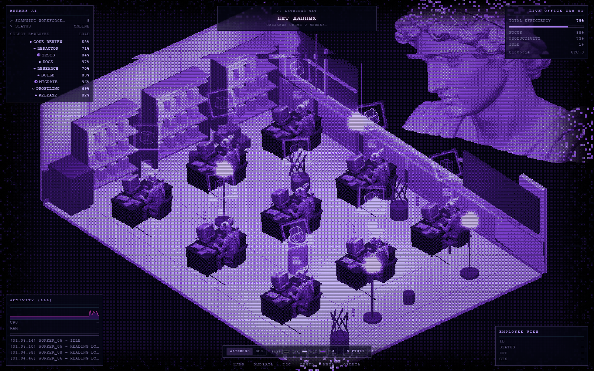
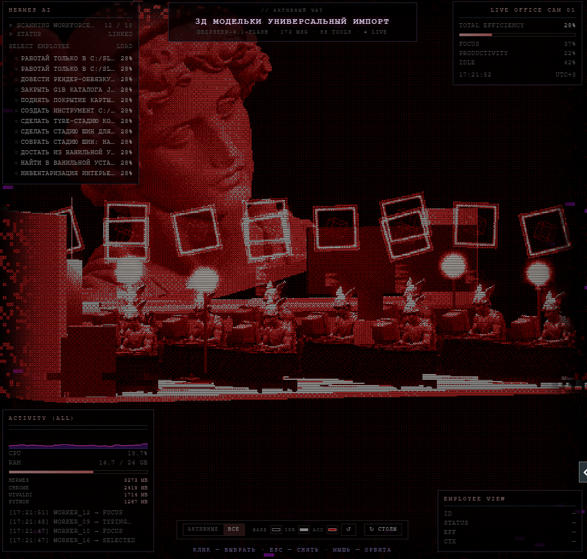
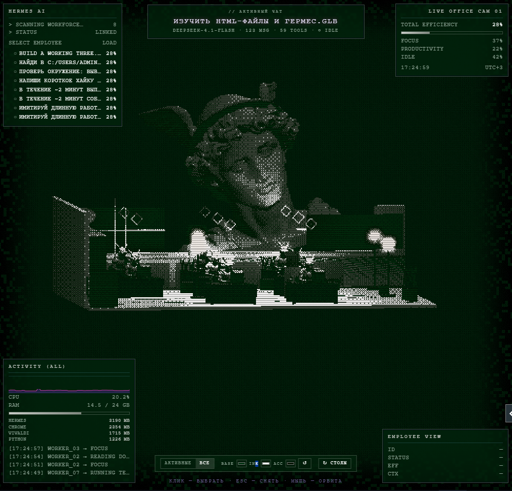
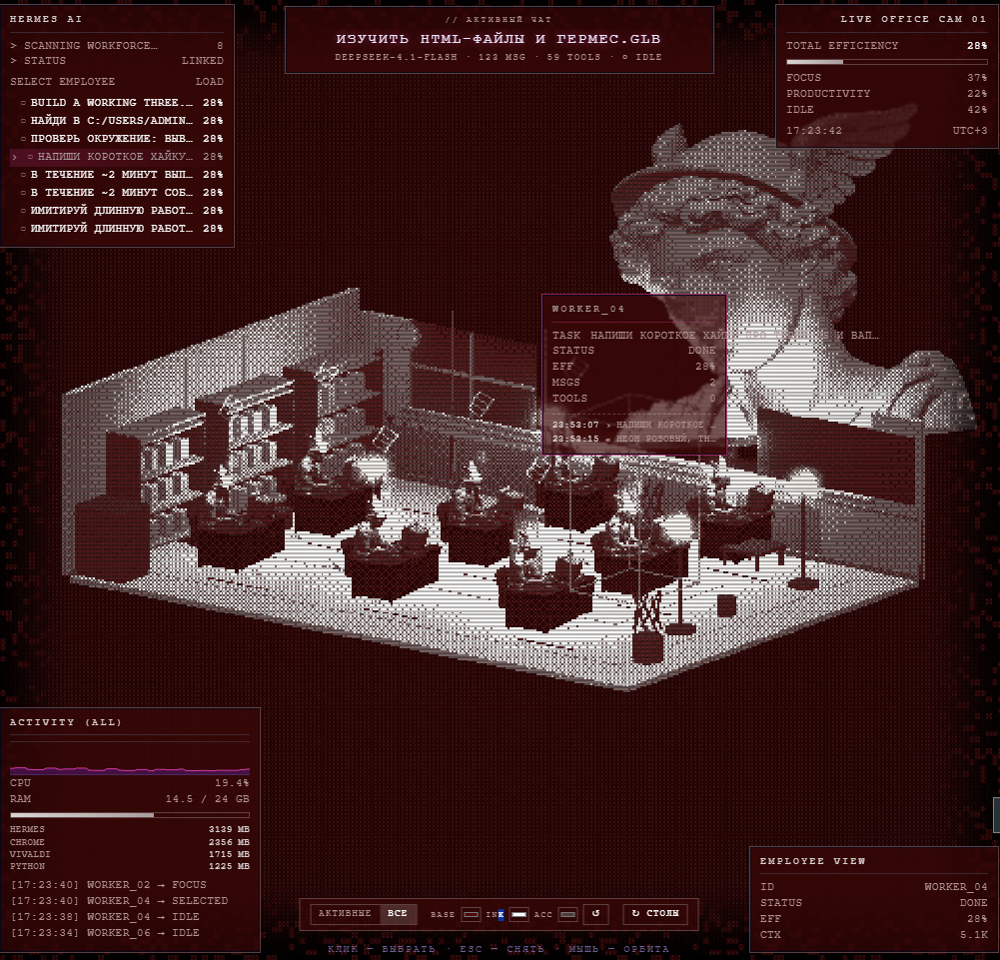

```
  ██╗  ██╗███████╗██████╗ ███╗   ███╗███████╗███████╗
  ██║  ██║██╔════╝██╔══██╗████╗ ████║██╔════╝██╔════╝
  ███████║█████╗  ██████╔╝██╔████╔██║█████╗  ███████╗
  ██╔══██║██╔══╝  ██╔══██╗██║╚██╔╝██║██╔══╝  ╚════██║
  ██║  ██║███████╗██║  ██║██║ ╚═╝ ██║███████╗███████║
  ╚═╝  ╚═╝╚══════╝╚═╝  ╚═╝╚═╝     ╚═╝╚══════╝╚══════╝
         s u b a g e n t s  ·  3 d  v i e w  ·  v a p o r w a v e
```

# ▓▒░ office_hermes ░▒▓ — офис, в котором твои субагенты реально работают

> ▍`SIGNAL ACQUIRED` · `127.0.0.1:8797` · `READ-ONLY` · `NO CLOUD` ▍
>
> ты пишешь задачу. агент запускает троих, пятерых, восьмерых.
> справа загорается панель: изометрический офис, CRT-мониторы, лампы,
> фигуры за столами — и на доске имя твоего чата.
>
> это не метафора и не скриншот с выставки. каждый стол — живая сессия
> из `state.db`. каждый лог — настоящий tool-вызов. каждые две секунды.



---

## ▍ что это

`office_hermes` — плагин для **Hermes desktop**, который превращает список
субагентов в наблюдаемый офис. Пока агент делегирует работу, ты видишь не
строчки в консоли, а сцену: кто за столом, кто шевелится, кто уснул, чем
занят главный агент, сколько ест машина.

Три вещи, которые делают это не игрушкой:

* **данные настоящие** — число столов равно числу дочерних сессий текущего чата,
  логи берутся из `messages`, статусы — из времени последнего сообщения;
* **всё локально** — сервер слушает только loopback, база открыта в режиме `mode=ro`;
* **работает без интернета** — страница офиса это один файл, three.js и модель вшиты.

---

## ▍ как это работает

```
   Hermes desktop                                  твоя машина
┌────────────────┬──────────────┐          ┌──────────────────────────────┐
│  чат           │  панель      │  iframe  │  office_live.py  :8797       │
│  агент ⟶       │  office_     │ ───────► │   ├─ /state?sid=   (JSON)    │
│  субагенты     │  hermes      │          │   ├─ /health       (диагност.)│
│                │              │          │   └─ /beacon       (живость)  │
│  state.db ─────┼── read-only ─┼─────────►│  office.html — three.js + GLB │
│  (SQLite)      │  plugin.js   │          │  (9.7 МБ, всё внутри)         │
└────────────────┴──────────────┘          └──────────────────────────────┘
```

1. **`plugin.js`** держит панель справа: `iframe` на фид, чип в статусбаре,
   команда в палитре `Ctrl+K`, авто-раскрытие при старте делегирования.
2. **`office_live.py`** — ~500 строк на голой стандартной библиотеке. Открывает
   `state.db` через `sqlite3 … ?mode=ro` и собирает `/state`: чат, воркеры,
   история чата, системные метрики. Кеш на секунду.
3. **`web/office.html`** — собранная сцена: three.js (IIFE-бандл), GLB-модель
   офиса в base64, шейдерный дизеринг, CRT-эффекты, весь HUD.
4. **страница опрашивает `/state`** каждые ~2 с и перестраивает столы:
   новый субагент → новый стол, завершённый → кубик над головой замирает.

Писать в базу фид физически не может — соединение `mode=ro`. Наружу не уходит
ничего: ни телеметрии, ни картинок, ни имён сессий.

---

## ▍ возможности

* ▸ **столы = субагенты.** `running` (<2 мин с последнего сообщения), `idle` (<15 мин),
  `done`. Если дочерних сессий ещё нет — задачи берутся из `async_delegations`.
* ▸ **два режима:** «активные» (только незавершённые) и «все» (вся история чата).
  Счётчик честный: `12 / 34` — на сцену ставится максимум `MAX_DESKS = 12`
  (у каждого воркера два источника света, на 30+ клонах forward-рендер ложится).
* ▸ **клик по фигуре** → карточка: задача, число сообщений и тулз, последние строки лога.
  Клик по главному агенту — то же самое про него.
* ▸ **кубик над головой** — вращается и мигает, пока агент работает.
* ▸ **палитра `↺`** из трёх цветов (`BASE`/`INK`/`ACC`) перекрашивает всю сцену:
  CSS, шейдерный дизеринг, свет мониторов. Выбор сохраняется.
* ▸ **`↻ столы`** — поворот офиса на 90° по часовой.
* ▸ **настоящий HUD:** активный чат, модель, `MSG · TOOLS · LIVE`, CPU/RAM и топ
  процессов — через `ctypes` (`GetSystemTimes`, `GlobalMemoryStatusEx`), psutil не нужен.
* ▸ **`/health` для диагностики:** версия, путь к базе, счётчики запросов,
  beacon-метки страницы (`beacon_boot`, `beacon_ready`).


---

## ▍ галерея

**одна сцена, разные палитры** — `↺` перекрашивает всё сразу: CSS, шейдерный дизеринг,
свет мониторов и ламп. Композиция и столы при этом не меняются.


*`SCANNING WORKFORCE · 12 / 18`, режим «все», ничего не выбрано.*


*та же сцена в зелёном: 8 столов, `ESC` снимает выбор.*

**клик по фигуре** — карточка воркера поверх сцены и заполненная панель `EMPLOYEE VIEW`:


*`WORKER_04` → `DONE`, `5.1K` контекста, последние строки лога; в ленте `WORKER_04 → SELECTED`.*

---

## ▍ вход (Windows)

> одна команда → один ярлык → офис открывается.

```powershell
git clone https://github.com/BIXXEZ/Hermes-subagents-HUB-3D-View-Waporvawe
cd Hermes-subagents-HUB-3D-View-Waporvawe
powershell -ExecutionPolicy Bypass -File scripts\install.ps1
```

Из git-bash то же самое: `bash scripts/install.sh`.

Дальше **три входа**, все рабочие:

| вход | что делает |
|---|---|
| **Пуск → `office_hermes`** | ярлык: если фид лежит — поднимет его и откроет офис в браузере |
| **Ctrl+K → `Reload desktop plugins`** | панель `office_hermes` появляется справа в Hermes |
| **<http://127.0.0.1:8797/>** | офис отдельным окном или на втором мониторе |

Установщик сам: находит `pythonw.exe` → копирует фид в `%LOCALAPPDATA%\hermes\office-live\` →
кладёт панель в `desktop-plugins\office-hermes\` с твоим портом → пишет лаунчер
`start-office.vbs` и вход `open-office.vbs` → создаёт ярлык в меню Пуск → прописывает
автозапуск → перезапускает фид и ждёт `/health`.

Ключи: `-Port 8801`, `-HermesHome D:\hermes`, `-PythonExe C:\Python312\pythonw.exe`,
`-NoAutostart`, `-NoStart`, `-NoShortcut`, `-Open`.

### macOS / Linux

```bash
bash scripts/install.sh --start
```

Файлы лягут в `$HERMES_HOME` (`~/.hermes`), фид поднимется через `python3`,
автозапуск — `systemd --user` или `~/.config/autostart/*.desktop` (строка `Exec=` печатается в конце).

### только панель, через сам Hermes

*Settings → Plugins → Install from Git* → `<логин>/hermes-office`. Скопируется только
`plugin.js`; **сервер и страницу** всё равно ставь скриптом (`scripts/install.ps1 -NoStart`),
иначе панель откроется пустой — ей некуда подключаться.

---

## ▍ что нужно

* Hermes desktop (панели плагинов) — Windows / macOS / Linux;
* Python 3.10+ (`pythonw.exe` на Windows), **без pip-зависимостей**;
* Node.js — только если хочешь пересобирать страницу офиса.

---

## ▍ файлы

| файл | роль |
|---|---|
| `plugin.js` | панель в Hermes: iframe на фид, чип в статусбаре, команда в палитре, авто-раскрытие |
| `server/office_live.py` | HTTP-фид `127.0.0.1:8797`: `/state?sid=`, `/health`, `/beacon`, `/` |
| `web/office.html` | собранный вьювер (three.js + GLB + шейдеры), отдаётся фидом |
| `build/src/viewer.html` | исходник вьювера (CSS/HTML/модуль) — единственное место для правок UI |
| `build/build_solo.py` | пересборка `web/office.html` из исходника |

---

## ▍ настройки

* **порт** — `-Port` (правит `BASE` в `plugin.js`, автозапуск и ярлык) или `OFFICE_PORT` / `--port`;
* **каталог Hermes** — `HERMES_HOME` / `--home` (по умолчанию `%LOCALAPPDATA%\hermes`, `~/.hermes`);
* **число столов** — `MAX_DESKS` в `build/src/viewer.html` + пересборка;
* **палитра по умолчанию** — `PAL` там же (`bg` / `ink` / `acc`).

---

## ▍ пересборка страницы

```bash
npm install                          # three, esbuild, @gltf-transform/cli
python build/build_solo.py           # → web/office.html
python build/build_solo.py --force   # пережать модель из assets/*.glb
```

`assets/office-small.glb` (6.7 МБ) — модель офиса после `resize 512` + `quantize`;
исходная сцена весит 48 МБ, поэтому в репозитории лежит только сжатая.

---

## ▍ удаление

```powershell
powershell -ExecutionPolicy Bypass -File scripts\uninstall.ps1
```

Останавливает **только свой** фид (по пути к `office-live`), убирает автозапуск,
ярлык из меню Пуск, `office-live\` и `desktop-plugins\office-hermes\`.
В Hermes — `Ctrl+K → Reload desktop plugins`.

---

## ▍ когда сигнал потерян

| симптом | лечение |
|---|---|
| панели нет после установки | плагины не hot-reload'ятся: **Ctrl+K → Reload desktop plugins** |
| панель есть, офиса нет | фид не запущен: `python "%LOCALAPPDATA%\hermes\office-live\office_live.py"`, смотри вывод или `office-live\feed.log` |
| «state.db не найден» | Hermes ещё ни разу не запускался либо другой `HERMES_HOME`: перезапусти фид с `--home` |
| порт занят | жива старая копия: `Get-CimInstance Win32_Process | ? CommandLine -like '*office_live*'` → `Stop-Process` |
| пусто в режиме «активные» | у чата все субагенты закончили — переключи на «все» |
| сцена тормозит | больше 12 столов не ставится намеренно; уменьши `MAX_DESKS` |
| офис грузится 10–20 с | норма: 9.7 МБ вместе с моделью, дальше из кеша |

Диагностика: <http://127.0.0.1:8797/health> — версия, путь к базе, счётчики запросов,
`beacon_boot` / `beacon_ready` (доехала ли страница внутри панели).

---

## ▍ лицензия

MIT — см. [LICENSE](LICENSE). Модель офиса и стиль — из личных ассетов автора.

```
 ░▒▓█ END OF TRANSMISSION █▓▒░  ·  твои агенты всё ещё работают  ·  ▍
```
